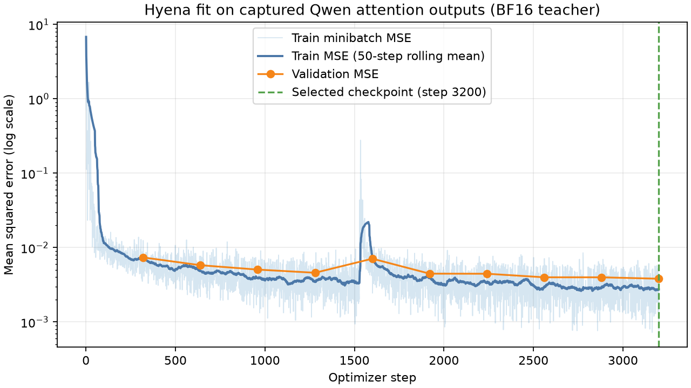
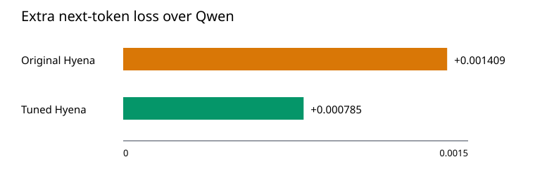
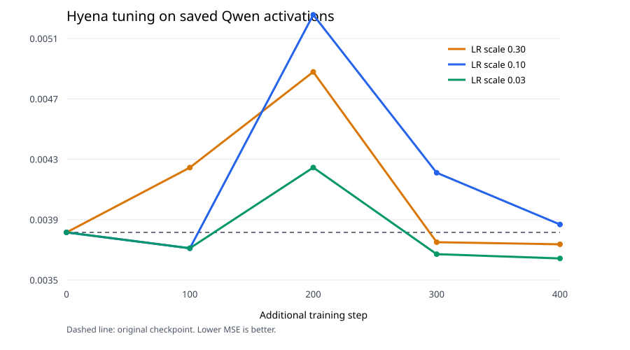

# LLM layer distillation

Trained on an **AMD Instinct MI300X** using AMD Developer Cloud.

Can a small Hyena model learn to do the job of one attention module inside Qwen2.5-7B?

Attention helps Qwen use earlier words to predict what comes next. I trained Hyena, which uses learned filters, to copy one attention module. Then I put it into Qwen and checked its predictions.

## How it works

1. Run text through Qwen and save the inputs and outputs of one attention module.
2. Train Hyena on those saved pairs until its outputs get closer to Qwen's.
3. Replace that attention module with Hyena and compare the model's predictions.

Qwen stays frozen. Only attention in the third block, `layers[2]` in code, is replaced.

I used 512 Wikipedia text sequences, with 358 for training, 77 for validation, and 77 for testing.

## Training

Hyena trained for 3,200 steps. Blue shows training error. Orange shows error on separate validation examples. Lower is better.

The error fell sharply, then improved more slowly. It rose around step 1,600 and recovered. Validation error was lowest at step 3,200.

## Did tuning help?

I continued training the saved Hyena model for another 400 steps with smaller learning rates.

| What I checked | Before tuning | After tuning |
| --- | ---: | ---: |
| Error when copying attention, measured as MSE | 0.00406211 | 0.00386767 |
| Qwen's next-word prediction loss with Hyena | 2.05611621 | 2.05549194 |

Lower is better for both. MSE measures how far Hyena's outputs are from Qwen's attention outputs.

Hyena's copying error improved by **4.79%**. For the second row, Qwen with its original attention scored **2.05470741**, so the tuned replacement still performed slightly worse.

Tuning removed **44.31% of the extra prediction loss caused by the replacement**. This is a reduction in the gap to Qwen.

See the three tuning attempts

Each line uses a different learning rate.

## What this result means

Hyena learned to copy part of Qwen, and tuning made the replacement closer to the original. It has not beaten Qwen's attention.

The comparison covers 77 sequences and 12,521 word pieces. Follow-up comparisons reused this test set, so the result needs checking on fresh text. Faster responses and better generated answers have not been demonstrated.

## License

[MIT](LICENSE)
